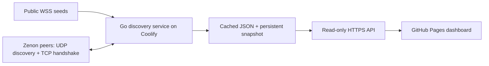

# Zenon Observatory

A mobile-friendly go-zenon version dashboard for GitHub Pages, backed by a small peer discovery API designed for Coolify.

The service uses the three public seeds to get initial peer identities, expands through **UDP discovery on port 35995**, and reads version names through the validator's **TCP/RLPx handshake**. The frontend shows provenance and timestamps for each observation. Counts are observations, never a claim to enumerate every node or pillar.

## Architecture



- `backend/`: Go service, Dockerfile, and Compose deployment. No blockchain database, wallet, votes, or transaction broadcasts. Uses go-zenon's legacy RLPx implementation for compatibility, with its own bounded discovery-v4 client.
- `src/`: React + TypeScript dashboard with a peer constellation, version distribution, search, filters, details, CSV export, and connection settings.
- `public/data/network.json`: real, timestamped bootstrap snapshot. It is **not demo data** and can become stale. Without an API configured, live seed results supplement this snapshot. Older nodes retain their individual observation times.
- `scripts/collect.ts`: optional RPC-only snapshot collector; useful for refreshing the bundled fallback. It does not implement P2P discovery.

## Deploy discovery on Coolify

1. Create an application from `https://github.com/0x3639/go-zenon-version`, branch `main`.
2. Select the **Dockerfile** build pack. Set **Base Directory** to `/backend` and **Dockerfile Location** to `/Dockerfile`.
3. Set **Ports Exposes** to `8080`. Attach your HTTPS domain, e.g. `https://discovery.example.com`. Coolify's reverse proxy routes HTTPS to container port 8080.
4. Add persistent storage mounted at `/data`. The container runs as UID/GID `10001`; storage must be writable by that user. Docker named volumes inherit the image directory's ownership. For a bind mount, provision its ownership before deployment.
5. Set `ALLOWED_ORIGINS=https://0x3639.com,https://0x3639.github.io` (use your actual Pages/custom-domain origin, without a path or trailing slash).
6. Set the health-check path to `/healthz`, and deploy. `/readyz` returns 503 until at least one peer is known.

The service needs **outbound TCP and UDP** to peer-advertised public addresses, normally port 35995, plus outbound DNS and HTTPS/WSS to the seeds. Replies must be allowed through the firewall/NAT. It uses outbound UDP sockets with ephemeral source ports; **no public inbound P2P port mapping is required**. Only the HTTP API needs the reverse proxy. Do not route UDP through an HTTP proxy.

Alternatively, from `backend/`, deploy `compose.yaml` as a Coolify Compose application and attach a domain to the `discovery` service on port 8080. The Compose host port is loopback-only for local use; Coolify should route through its application network.

### Configuration

| Variable | Default | Meaning |
| --- | --- | --- |
| `PORT` | `8080` | API listen port |
| `DATA_DIR` | `/data` | Private discovery identity and cached snapshot |
| `ALLOWED_ORIGINS` | `https://0x3639.com,https://0x3639.github.io` | Comma-separated browser origins; no wildcard |
| `SEED_URLS` | The three seeds below | Comma-separated WSS/HTTPS RPC endpoints, maximum 8 |
| `SCAN_INTERVAL` | `10m` | Pause between completed scans |
| `SCAN_BUDGET` | `3m` | Maximum scan duration (10s–10m) |
| `MAX_NODES` | `256` | Maximum P2P candidates probed per scan (1–1000) |
| `CONCURRENCY` | `4` | Simultaneous peer probes (1–8) |

Default seeds:

- `wss://my.hc1node.com:35998`
- `wss://node.zenonhub.io:35998`
- `wss://node.atsocy.com:35998`

The service retains observations for 24 hours, rotates candidates and bootstrap nodes between scans, queries three random discovery targets per responsive UDP peer, preserves its discovery identity across restarts, and publishes partial results as a scan progresses. The configured budget can limit coverage; inspect `limited`, `scanning`, and individual `lastSeen` values. The API reports observed peer identities, not registered pillars or confirmed chain membership. Handshake observations are of nodes reachable from the Zenon seed/discovery graph, but the service does not execute the chain-status handshake or validate a genesis hash. `pillarCount` is a separate on-chain registry count from `embedded.pillar.getAll`, with its own check timestamp; it is not a denominator for peer coverage.

### API

| Route | Result |
| --- | --- |
| `GET /api/v1/network` | Full snapshot: nodes, source successes/failures, scan state, release metadata |
| `GET /api/v1/nodes` | `{ generatedAt, nodes }` |
| `GET /healthz` | Process health, scan state, observation count, last update |
| `GET /readyz` | 200 once observations exist, otherwise 503 |

Endpoints support HEAD and OPTIONS. Data responses use ETags and 30-second caching. There is no public scan trigger, target parameter, or mutation API. Anyone can read the public data; CORS controls which browser origins can consume it, not authentication.

Node fields include `id` (128-character public key), `ip`, `name`, `version` (nullable), `reportedVersions`, `evidence`, `sources`, `rpcEndpoints`, `firstSeen`, `lastSeen`, and P2P ports. Evidence is `p2p`, `rpc`, `peer`, or `discovery`. Versions are self-reported; authenticated P2P identity does not prove the running binary.

## Publish the frontend on GitHub Pages

1. Push the repository to GitHub.
2. In **Settings → Pages**, set the source to **GitHub Actions**.
3. In **Settings → Secrets and variables → Actions → Variables**, add repository variable `DISCOVERY_API_URL` with the HTTPS base URL of the Coolify service, e.g. `https://discovery.example.com` (no `/api/v1/network` suffix).
4. Run **Publish dashboard**, or push a frontend change to `main`.

GitHub Pages currently inherits the account’s custom domain: `https://0x3639.com/go-zenon-version/` (the standard Pages URL is `https://0x3639.github.io/go-zenon-version/`). Vite uses relative asset paths, so project Pages paths and custom domains both work. The configured API is polled once a minute while the tab is visible. Visitors can override the URL in Connection settings; an empty URL uses live public seeds and the bundled snapshot.

The workflow builds with Node inside a job container. No server-side component runs on GitHub Pages, and no API credential is embedded in the frontend.

## Local development

All dependency installation and execution must stay in containers. From the repository root:

```sh
nodebox npm ci
nodebox npm test
nodebox npm run build
docker compose up -d
```

Open `http://localhost:3000`. The preview binds to `0.0.0.0` inside the container and publishes only on host loopback. On systems with a different UID/GID, set `LOCAL_UID` and `LOCAL_GID` to the output of `id -u` and `id -g`.

Start the discovery service locally:

```sh
ALLOWED_ORIGINS=http://localhost:3000 docker compose -f backend/compose.yaml up --build -d
```

Set the frontend's Connection settings to `http://localhost:8080`. HTTP is permitted only for local development. Stop both services with their corresponding `docker compose down` commands when finished; volumes preserve discovery state.

Refresh the real RPC fallback snapshot:

```sh
nodebox npm run collect
```

The collector uses bounded requests to discovered **public IPs** on port 35997. It refuses redirects and private/reserved destinations and retains the previous file when every seed fails. HTTPS/WSS seeds validate certificates; peer HTTP responses are untrusted self-reports. Use the Coolify service for non-RPC peers.

## Coverage and references

One seed's connected peers are only one neighborhood. UDP `findnode` returns a bounded set of neighbors near a target, not the entire network. Nodes may be private, offline, behind NAT, at capacity, or unwilling to complete a handshake. Running over time improves coverage; an exact total is unknowable from this crawler. Multiple pillar registrations are not equivalent to peer identities, and regular/sentinel nodes also participate.

The dashboard parses the raw `name` field because the current TypeScript SDK's `Peer.fromJson` omits it. Unknown and conflicting version reports remain visible. Upstream `stats.networkInfo` can also truncate IPv6 addresses; the P2P path uses its own address parsing.

- [go-zenon statistics API](https://github.com/zenon-network/go-zenon/blob/master/rpc/api/stats.go)
- [go-zenon P2P implementation](https://github.com/zenon-network/go-zenon/tree/master/p2p)
- [TypeScript SDK peer model](https://github.com/digitalSloth/znn-typescript-sdk/blob/main/src/model/stats.ts)
- [sol-znn node parser](https://github.com/sol-znn/znn-node-parser) — reviewed as a reference for RPC-based crawling; its source was not copied.
- [Coolify Dockerfile deployment documentation](https://coolify.io/docs/applications/builds/dockerfile)
- [GitHub Pages custom workflow documentation](https://docs.github.com/en/pages/getting-started-with-github-pages/using-custom-workflows-with-github-pages)

Go dependencies include go-zenon and go-ethereum and retain their upstream licenses. See `backend/go.mod` / `go.sum` for pinned versions. The discovery code intentionally uses the validator's legacy handshake implementation for compatibility.
