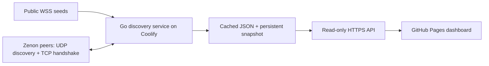

# Zenon Observatory

A mobile-friendly go-zenon version dashboard for GitHub Pages, backed by a small peer discovery API designed for Coolify.

The service uses the three public seeds to get initial peer identities, expands through **UDP discovery on port 35995**, and reads version names through the validator's **TCP/RLPx handshake**. The frontend shows provenance and timestamps for each observation. Counts are observations, never a claim to enumerate every node or pillar.

## Architecture



- `backend/`: Go service, Dockerfile, and Compose deployment. No blockchain database, wallet, votes, or transaction broadcasts. Uses go-zenon's legacy RLPx implementation for compatibility, with its own bounded discovery-v4 client.
- `src/`: React + TypeScript dashboard with a peer constellation, version distribution, search, filters, details, CSV export, and connection settings.
- `public/data/network.json`: real, timestamped bootstrap snapshot. It is **not demo data** and can become stale. Without an API configured, live seed results supplement this snapshot. Older nodes retain their individual observation times.
- `scripts/collect.ts`: optional RPC-only snapshot collector; useful for refreshing the bundled fallback. It does not implement P2P discovery.

## Deploy discovery on Coolify

1. Create an application from `https://github.com/0x3639/go-zenon-version`, branch `main`.
2. Select the **Dockerfile** build pack. Set **Base Directory** to `/backend` and **Dockerfile Location** to `/Dockerfile`.
3. Set **Ports Exposes** to `8080` and the **runtime environment variable `PORT=8080`**. Replace an existing `PORT=3000` if Coolify created one. Both values must agree. Attach your HTTPS domain, e.g. `https://discovery.example.com`. Coolify's reverse proxy routes HTTPS to container port 8080.
4. Add persistent storage mounted at `/data`. The container runs as UID/GID `10001`; storage must be writable by that user. Docker named volumes inherit the image directory's ownership. For a bind mount, provision its ownership before deployment.
5. Set `ALLOWED_ORIGINS=https://0x3639.com,https://0x3639.github.io` (use your actual Pages/custom-domain origin, without a path or trailing slash).
6. Set the health-check path to `/healthz`, and deploy. `/readyz` returns 503 until at least one peer is known.

The image defaults to port 8080, and its built-in health check follows the runtime `PORT` variable. If a deployment log says `discovery API listening on :3000`, Coolify supplied a runtime override; set `PORT=8080` and keep Ports Exposes at `8080`, then redeploy. A `connection refused` health-check error in this case is a port mismatch, not a missing `wget` command.

The service needs **outbound TCP and UDP** to peer-advertised public addresses, normally port 35995, plus outbound DNS and HTTPS/WSS to the seeds. Replies must be allowed through the firewall/NAT. It uses outbound UDP sockets with ephemeral source ports; **no public inbound P2P port mapping is required**. Only the HTTP API needs the reverse proxy. Do not route UDP through an HTTP proxy.

Alternatively, from `backend/`, deploy `compose.yaml` as a Coolify Compose application and attach a domain to the `discovery` service on port 8080. The Compose host port is loopback-only for local use; Coolify should route through its application network.

### Configuration

| Variable | Default | Meaning |
| --- | --- | --- |
| `PORT` | `8080` | API listen port |
| `DATA_DIR` | `/data` | Private discovery identity, cached snapshot, and durable crawl queue |
| `ALLOWED_ORIGINS` | `https://0x3639.com,https://0x3639.github.io` | Comma-separated browser origins; no wildcard |
| `SEED_URLS` | The three seeds below | Comma-separated WSS/HTTPS RPC endpoints, maximum 8 |
| `SCAN_INTERVAL` | `10m` | Pause after the entire known queue is drained; unfinished batches resume after 5 seconds |
| `SCAN_BUDGET` | `3m` | Maximum duration of one batch (10s–10m); remaining work stays queued |
| `MAX_NODES` | `256` | Maximum endpoint attempts per batch (1–1000), not a cap on total coverage |
| `CONCURRENCY` | `4` | Simultaneous peer probes (1–8) |
| `PILLAR_PEERS_JSON` | Empty | Optional JSON object mapping pillar producing addresses to complete 128-character P2P public keys; never infer links from IPs |

Default seeds:

- `wss://my.hc1node.com:35998`
- `wss://node.zenonhub.io:35998`
- `wss://node.atsocy.com:35998`

The service retains observations for 24 hours and stores its pending queue in `/data/crawl.json`. Every discovered public endpoint and every upstream bootstrap seed enters that queue. It attempts an authenticated TCP/RLPx hello and queries three random UDP discovery targets per peer, adds new neighbors, and resumes unfinished batches after five seconds. A completed pass means every currently known endpoint was attempted, including failures; it does not mean every node in the network was reached. Later passes retry retained endpoints after `SCAN_INTERVAL`. The queue and results are checkpointed after each batch of concurrent probes, so a restart resumes pending work. Interrupted probes return to the queue rather than being recorded as failed connections. The queue is bounded at 5,000 candidate endpoints, and `crawl.capped` exposes that limit. Inspect `crawl.pending`, `crawl.completedPasses`, `limited`, `scanning`, and each observation timestamp. The API reports observed peer identities, not registered pillars or confirmed chain membership. Handshake observations are of nodes reachable from the Zenon seed/discovery graph, but the service does not execute the chain-status handshake or validate a genesis hash. `pillarCount` is a separate on-chain registry count from `embedded.pillar.getAll`, with its own check timestamp; it is not a denominator for peer coverage.

The peer explorer labels **go-zenon seeds** by public-key membership in the validator's `p2p.DefaultSeeders` list, and **RPC seeds** by the configured endpoints' own identities. Use **Filter by node role** to show either type, all seeds, or other peers. CSV exports include those roles. Seed-list membership does not imply reachability: only observed peers enter node totals. The 116-entry catalog in `src/go-zenon-seeds.ts` is pinned to upstream commit `bb39e31c608dc397a91b98b21b096bca99a9f4d6` and matches the backend's `v0.0.9-alphanet` dependency; refresh it when updating the upstream seed list. IP addresses alone never assign a seed label.

### API

| Route | Result |
| --- | --- |
| `GET /api/v1/network` | Full snapshot: nodes, source successes/failures, scan state, release metadata |
| `GET /api/v1/nodes` | `{ generatedAt, nodes }` |
| `GET /api/v1/ips` | `{ generatedAt, ips }`: one record per observed public IP, with all node identities and direct-connection counts |
| `GET /api/v1/momentums` | Upcoming production projections, recent outcomes, replay checks, and explicitly linked pillar versions |
| `GET /healthz` | Process health, scan state, observation count, last update |
| `GET /readyz` | 200 once observations exist, otherwise 503 |

Endpoints support HEAD and OPTIONS. Data responses use ETags and 30-second caching. There is no public scan trigger, target parameter, or mutation API. Anyone can read the public data; CORS controls which browser origins can consume it, not authentication.

Node fields include `id` (128-character public key), `ip`, `name`, `version` (nullable), `reportedVersions`, `evidence`, `sources`, `rpcEndpoints`, `firstSeen`, `lastSeen`, and P2P ports. Evidence is `p2p`, `rpc`, `peer`, or `discovery`. Optional `handshake` records contain `status` (`confirmed` or `failed`), the checked `ip` and `port`, `attemptedAt`, `lastSuccessAt`, and an error for unsuccessful attempts. `lastDiscoveryAt` records an authenticated UDP response. Referrals cannot refresh direct proof; changing an address or port requires a new check. Failed retries preserve earlier successful timestamps and advertised peers, since NAT, firewalls, connection limits, and peer policy can block inbound access. Versions are self-reported; authenticated P2P identity does not prove the running binary.

Peer identities and endpoint attempts are deduplicated separately. The IP endpoint and **Unique IPs** CSV export group addresses while preserving distinct keys behind the same IP. The frontend can filter by P2P result and shows observed unique IPs separately from candidate counts. Listed but unobserved bootstrap endpoints remain in the crawl ledger and never inflate the observed-node count.

### Momentum watch

Redeploy the latest backend in Coolify to enable `/api/v1/momentums`; existing port, storage, and seed settings still apply. The frontend handles an older backend's 404 with a waiting state. A separate bounded worker queries the configured RPC seeds every ten seconds, fails over between them, checks mainnet and contiguous header history, and reconstructs elections using the pinned `go-zenon/consensus` implementation. It reads current pillar weights and 180 recent momentums and serves the previous, current, and next round when the proof cutoff is covered. No full-node database or extra port is needed. The endpoint supports GET/HEAD/OPTIONS, ETags, and five-second caching.

The result is always labeled **RPC projection**: cached public weights are not authoritative historical election state. `matched` / `checked` report comparisons with actual producers; mismatches are visible. Counts are recomputed from each bounded window, not lifetime statistics. A fresh response can contain a stale frontier; the UI checks both and pauses its countdown. It only calls a slot empty when a later momentum has been observed. The reference design was [Zenon TV's spork timing tool](https://tools.zenon.tv/spork); no code or feed was copied from it.

Versions default to unknown because a pillar's Ed25519 producing address is not its secp256k1 peer identity. To attach versions later, set `PILLAR_PEERS_JSON` to a JSON object whose keys are verified producing addresses and whose values are their known peer public keys, then redeploy. There is deliberately no speculative name/IP matching. Configured links are operator assertions; the UI says so. Mapped observations older than one hour are hidden, and source evidence, times, and conflicting reports are retained. Seeing a momentum first from an IP identifies a relay observation, not proof that the IP belongs to the pillar. This release does not collect persistent P2P propagation telemetry.

The compact public-chain fixture in `backend/testdata/momentum-schedule.json` checks exact replay of 150 observed producers. The additional live check is opt-in (`CHECK_LIVE_SCHEDULE=1 go test -run TestLiveSchedule -v .` inside a Go container). Frontend checks cover invalid attribution, stale data, mismatches, and avoiding false missed-slot claims.

## Publish the frontend on GitHub Pages

1. Push the repository to GitHub.
2. In **Settings → Pages**, set the source to **GitHub Actions**.
3. In **Settings → Secrets and variables → Actions → Variables**, add repository variable `DISCOVERY_API_URL` with the HTTPS base URL of the Coolify service, e.g. `https://discovery.example.com` (no `/api/v1/network` suffix).
4. Run **Publish dashboard**, or push a frontend change to `main`.

GitHub Pages currently inherits the account’s custom domain: `https://0x3639.com/go-zenon-version/` (the standard Pages URL is `https://0x3639.github.io/go-zenon-version/`). Vite uses relative asset paths, so project Pages paths and custom domains both work. The configured API is polled once a minute while the tab is visible. Visitors can override the URL in Connection settings; an empty URL uses live public seeds and the bundled snapshot.

The workflow builds with Node inside a job container. No server-side component runs on GitHub Pages, and no API credential is embedded in the frontend.

### Experimental Observer panel

The separate P2P Observer has an optional frontend panel. It is **off by default** and must remain off until its collection pilot passes and the operator enables it. Healthy responses never enable it automatically. The existing discovery service and Momentum watch do not depend on the Observer.

| Setting | Default | Purpose |
| --- | --- | --- |
| `OBSERVER_ENABLED` GitHub Actions repository variable | Unset / off | Only the exact string `true` enables the panel in the next Pages build |
| `OBSERVER_API_URL` GitHub Actions repository variable | Supplied Coolify Observer origin | Optional HTTPS origin override, without a path, query, credentials, or fragment |
| `VITE_OBSERVER_ENABLED` | Off | Equivalent flag for direct Vite builds |
| `VITE_OBSERVER_API_URL` | `https://zsjo46q7s0qcmaklbmak7gfp.172.245.238.165.sslip.io` | Independent Observer API origin |

After pilot acceptance, set `OBSERVER_ENABLED=true` and run **Publish dashboard**. Disable it by removing the variable or setting it to `false`, then rebuild. No Coolify change or discovery backend redeploy is needed for this frontend feature. There is no query-string or browser-settings bypass. Disabled builds render neither the panel nor its navigation link and make no Observer requests; the panel is lazy loaded and has its own render error boundary.

When enabled, **Observer · Experimental** appears below the peer explorer. Collection status, up to 100 peer sessions, the latest 25 returned checked momentums, and analysis availability refresh independently about every 30 seconds while the tab is visible. Requests time out after ten seconds, reject bodies above 1 MiB, and back off after failures (up to two minutes, or up to five minutes for `Retry-After`). Expanding a momentum fetches its arrival evidence and dated pillar names; closing it cancels that detail's requests and polling. No per-momentum requests are made for collapsed rows. Failed routes retain their last successful observations and original timestamps without blocking the other routes or panels.

Every feed exposes `generatedAt`, its query window, and expandable `dataQuality`. Snapshots are stale after 90 seconds, or when operational status is that old; reference freshness is checked separately against a two-minute threshold. A browser clock more than 30 seconds behind those times also marks them stale. Collection counts and run-level quality counters have different windows, as labeled. Default API query windows can lag by up to 30 seconds. Lists are bounded previews and never claim full history or network coverage.

Versions are labeled **Relay advertised version**. `producerSoftwareVersion: null` stays **Unknown**. Arrival event kinds, original UTC timestamp precision, capture exclusions, session identities, and verification states remain visible. Requested responses are not treated as unsolicited broadcasts. Pillar names are dated snapshots; no historical ownership is inferred. `/api/v1/associations` reports `available: false`, so analysis remains pending. The frontend never derives pillar ownership from IPs, ranks relays, or writes `PILLAR_PEERS_JSON`.

The API is public, uses envelopes under `result` and list rows under `result.data`, and needs no API key. CORS currently permits `https://0x3639.com`. Local previews need an explicitly allowed local origin on a test API or a development-only proxy; never disable certificate validation or put credentials in the frontend. Local HTTP API origins are accepted only in Vite development mode. To check an enabled build in a container: `nodebox env VITE_OBSERVER_ENABLED=true npm run build`.

Contract reference: [API documentation](https://github.com/0x3639/go-zenon-pillar-version/blob/588786bb804d08df733057993668c86047f937ab/docs/api.md), [Observer OpenAPI](https://github.com/0x3639/go-zenon-pillar-version/blob/588786bb804d08df733057993668c86047f937ab/docs/openapi.json). The Observatory's own `openapi.json` continues to describe its discovery API; the Observer is a separate service.

### Branding, search, and LLM discovery

The dashboard and static guide include canonical URLs, Open Graph and Twitter cards, JSON-LD structured data, and links to machine-readable documentation. The shared angular Z mark supplies the header logo, SVG/ICO/PNG favicons, Apple touch icon, and web manifest icons. The social image is a 1200×630 PNG with illustrative peer graphics and no changing network totals.

- [Usage and interpretation guide](https://0x3639.com/go-zenon-version/guide/) works without JavaScript and explains observation evidence, seed roles, timestamps, hidden nodes, and count definitions.
- [llms.txt](https://0x3639.com/go-zenon-version/llms.txt) provides a concise discovery index; [llms-full.txt](https://0x3639.com/go-zenon-version/llms-full.txt) contains the complete guide. Equivalent Markdown pages are linked from HTML with `rel="alternate"`.
- [OpenAPI](https://0x3639.com/go-zenon-version/openapi.json) describes the public read-only API; [sitemap.xml](https://0x3639.com/go-zenon-version/sitemap.xml) lists the dashboard and guide.

Edit the logo in `assets/brand/mark.svg`, the social composition in `scripts/generate-assets.ts`, and the guide in `content/guide.md`. `src/site.ts` owns the canonical site URL and default API address; the build's `VITE_DISCOVERY_API_URL` also sets documentation API links. `nodebox npm run generate` refreshes generated public assets and the bounded metadata block in `index.html`. The regular build generates them automatically, then verifies the emitted links, image dimensions, metadata, and API references. The bundled DM Sans font is used only for image generation and includes its SIL Open Font License in `assets/brand/OFL.txt`.

`robots.txt` belongs at the hostname root, outside this project Pages path. The account site's `https://0x3639.com/robots.txt` allows crawling as of 2026-11-07. A project-local robots file would not control this site. The sitemap can be submitted in the domain owner's search tools or linked from that root robots file. Search-result favicons are also hostname-scoped, so search engines may use the account site's favicon while browser tabs use this project's mark. These files make content accessible and easier to interpret; they do not guarantee indexing, ranking, or inclusion in AI answers.

## Local development

All dependency installation and execution must stay in containers. From the repository root:

```sh
nodebox npm ci
nodebox npm test
nodebox npm run build
docker compose up -d
```

Open `http://localhost:3000`. The preview binds to `0.0.0.0` inside the container and publishes only on host loopback. On systems with a different UID/GID, set `LOCAL_UID` and `LOCAL_GID` to the output of `id -u` and `id -g`.

Start the discovery service locally:

```sh
ALLOWED_ORIGINS=http://localhost:3000 docker compose -f backend/compose.yaml up --build -d
```

Set the frontend's Connection settings to `http://localhost:8080`. HTTP is permitted only for local development. Stop both services with their corresponding `docker compose down` commands when finished; volumes preserve discovery state.

Refresh the real RPC fallback snapshot:

```sh
nodebox npm run collect
```

The collector uses bounded requests to discovered **public IPs** on port 35997. It refuses redirects and private/reserved destinations and retains the previous file when every seed fails. HTTPS/WSS seeds validate certificates; peer HTTP responses are untrusted self-reports. Use the Coolify service for non-RPC peers.

## Coverage and references

One seed's connected peers are only one neighborhood. UDP `findnode` returns a bounded set of neighbors near a target, not the entire network. Nodes may be private, offline, behind NAT, at capacity, or unwilling to complete a handshake. Running over time improves coverage; an exact total is unknowable from this crawler. Multiple pillar registrations are not equivalent to peer identities, and regular/sentinel nodes also participate.

The dashboard parses the raw `name` field because the current TypeScript SDK's `Peer.fromJson` omits it. Unknown and conflicting version reports remain visible. Upstream `stats.networkInfo` can also truncate IPv6 addresses; the P2P path uses its own address parsing.

- [go-zenon statistics API](https://github.com/zenon-network/go-zenon/blob/master/rpc/api/stats.go)
- [go-zenon P2P implementation](https://github.com/zenon-network/go-zenon/tree/master/p2p)
- [TypeScript SDK peer model](https://github.com/digitalSloth/znn-typescript-sdk/blob/main/src/model/stats.ts)
- [sol-znn node parser](https://github.com/sol-znn/znn-node-parser) — reviewed as a reference for RPC-based crawling; its source was not copied.
- [Coolify Dockerfile deployment documentation](https://coolify.io/docs/applications/builds/dockerfile)
- [GitHub Pages custom workflow documentation](https://docs.github.com/en/pages/getting-started-with-github-pages/using-custom-workflows-with-github-pages)

Go dependencies include go-zenon and go-ethereum and retain their upstream licenses. See `backend/go.mod` / `go.sum` for pinned versions. The discovery code intentionally uses the validator's legacy handshake implementation for compatibility.
