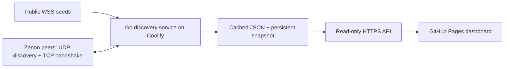

# Zenon Observatory

A mobile-friendly go-zenon version dashboard for GitHub Pages, backed by a small peer discovery API designed for Coolify.

The service uses the three public seeds to get initial peer identities, expands through **UDP discovery on port 35995**, and reads version names through the validator's **TCP/RLPx handshake**. The frontend shows provenance and timestamps for each observation. Counts are observations, never a claim to enumerate every node or pillar.

## Architecture



- `backend/`: Go service, Dockerfile, and Compose deployment. Stores a compact RPC header/interval history, with no full-node database, wallet, votes, or transaction broadcasts. Uses go-zenon's legacy RLPx implementation for compatibility, with its own bounded discovery-v4 client.
- `src/`: React + TypeScript dashboard with a peer constellation, version distribution, search, filters, details, CSV export, and connection settings.
- `public/data/network.json`: real, timestamped bootstrap snapshot. It is **not demo data** and can become stale. Without an API configured, live seed results supplement this snapshot. Older nodes retain their individual observation times.
- `scripts/collect.ts`: optional RPC-only snapshot collector; useful for refreshing the bundled fallback. It does not implement P2P discovery.

## Deploy discovery on Coolify

1. Create an application from `https://github.com/0x3639/go-zenon-version`, branch `main`.
2. Select the **Dockerfile** build pack. Set **Base Directory** to `/backend` and **Dockerfile Location** to `/Dockerfile`.
3. Set **Ports Exposes** to `8080` and the **runtime environment variable `PORT=8080`**. Replace an existing `PORT=3000` if Coolify created one. Both values must agree. Attach your HTTPS domain, e.g. `https://discovery.example.com`. Coolify's reverse proxy routes HTTPS to container port 8080.
4. Add persistent storage mounted at `/data`. The container runs as UID/GID `10001`; storage must be writable by that user. Docker named volumes inherit the image directory's ownership. For a bind mount, provision its ownership before deployment.
5. Set `ALLOWED_ORIGINS=https://0x3639.com,https://0x3639.github.io` (use your actual Pages/custom-domain origin, without a path or trailing slash).
6. Set the health-check path to `/healthz`, and deploy. `/readyz` returns 503 until at least one peer is known.

The image defaults to port 8080, and its built-in health check follows the runtime `PORT` variable. If a deployment log says `discovery API listening on :3000`, Coolify supplied a runtime override; set `PORT=8080` and keep Ports Exposes at `8080`, then redeploy. A `connection refused` health-check error in this case is a port mismatch, not a missing `wget` command.

The service needs **outbound TCP and UDP** to peer-advertised public addresses, normally port 35995, plus outbound DNS and HTTPS/WSS to the seeds. Replies must be allowed through the firewall/NAT. It uses outbound UDP sockets with ephemeral source ports; **no public inbound P2P port mapping is required**. Only the HTTP API needs the reverse proxy. Do not route UDP through an HTTP proxy.

Alternatively, from `backend/`, deploy `compose.yaml` as a Coolify Compose application and attach a domain to the `discovery` service on port 8080. The Compose host port is loopback-only for local use; Coolify should route through its application network.

### Configuration

| Variable | Default | Meaning |
| --- | --- | --- |
| `PORT` | `8080` | API listen port |
| `DATA_DIR` | `/data` | Private discovery identity, cached snapshot, durable crawl queue, and production SQLite history |
| `ALLOWED_ORIGINS` | `https://0x3639.com,https://0x3639.github.io` | Comma-separated browser origins; no wildcard |
| `SEED_URLS` | The three seeds below | Comma-separated WSS/HTTPS RPC endpoints, maximum 8 |
| `SCAN_INTERVAL` | `10m` | Pause after the entire known queue is drained; unfinished batches resume after 5 seconds |
| `SCAN_BUDGET` | `3m` | Maximum duration of one batch (10s–10m); remaining work stays queued |
| `MAX_NODES` | `256` | Maximum endpoint attempts per batch (1–1000), not a cap on total coverage |
| `CONCURRENCY` | `4` | Simultaneous peer probes (1–8) |
| `PRODUCTION_SINCE` | `2026-11-15T15:49:00Z` | Inclusive production-reporting boundary; changing it rebuilds stored counts |
| `PILLAR_PEERS_JSON` | Empty | Optional JSON object mapping pillar producing addresses to complete 128-character P2P public keys; never infer links from IPs |

Default seeds:

- `wss://my.hc1node.com:35998`
- `wss://node.zenonhub.io:35998`
- `wss://node.atsocy.com:35998`

The service retains observations for 24 hours and stores its pending queue in `/data/crawl.json`. Every discovered public endpoint and every upstream bootstrap seed enters that queue. It attempts an authenticated TCP/RLPx hello and queries three random UDP discovery targets per peer, adds new neighbors, and resumes unfinished batches after five seconds. A completed pass means every currently known endpoint was attempted, including failures; it does not mean every node in the network was reached. Later passes retry retained endpoints after `SCAN_INTERVAL`. The queue and results are checkpointed after each batch of concurrent probes, so a restart resumes pending work. Interrupted probes return to the queue rather than being recorded as failed connections. The queue is bounded at 5,000 candidate endpoints, and `crawl.capped` exposes that limit. Inspect `crawl.pending`, `crawl.completedPasses`, `limited`, `scanning`, and each observation timestamp. The API reports observed peer identities, not registered pillars or confirmed chain membership. Handshake observations are of nodes reachable from the Zenon seed/discovery graph, but the service does not execute the chain-status handshake or validate a genesis hash. `pillarCount` is a separate on-chain registry count from `embedded.pillar.getAll`, with its own check timestamp; it is not a denominator for peer coverage.

The peer explorer labels **go-zenon seeds** by public-key membership in the validator's `p2p.DefaultSeeders` list, and **RPC seeds** by the configured endpoints' own identities. Use **Filter by node role** to show either type, all seeds, or other peers. CSV exports include those roles. Seed-list membership does not imply reachability: only observed peers enter node totals. The 116-entry catalog in `src/go-zenon-seeds.ts` is pinned to upstream commit `bb39e31c608dc397a91b98b21b096bca99a9f4d6` and matches the backend's `v0.0.9-alphanet` dependency; refresh it when updating the upstream seed list. IP addresses alone never assign a seed label.

### Peer version scope

Following the spork, the peer dashboard excludes advertised versions below **v0.0.9**, using the explicit `MIN_PEER_VERSION` policy in `src/network-summary.ts`. The cutoff is inclusive and independent of the latest release lookup. It filters counts, charts, map seed markers, the explorer, and exports consistently, including fallback data. Unknown versions remain unclassified. Older versions are not deleted from the collector. The scope notice reports the hidden count; it never labels retained peers as belonging to a verified chain.

This cutoff follows the requested threshold. The [v0.0.10 release notes](https://github.com/zenon-network/go-zenon-releases/releases/tag/v0.0.10) require v0.0.10 for the spork renewal, so a visible v0.0.9 peer is not a compatibility endorsement. Momentum records retain their recorded timestamps and producing addresses. Crawl diagnostics describe the full collector workload. This is a frontend change: merge to publish GitHub Pages; no Coolify redeploy is needed for the version scope.

### Peer totals and release labels

The overview and default explorer show **Reported peers** (RPC, peer-list, or P2P software-name evidence). Discovery-only neighbor referrals have their own count and **View discovery candidates** action; **All in scope** retains every API identity that passes the version cutoff. Failed inbound attempts and unparseable software reports remain visible. Peer collection, retention, and identity/IP deduplication are unchanged.

The adoption card counts only peers with known versions. A version newer than the GitHub release record is shown as **Highest observed version**, with the published version and lookup time separately visible. Peer advertisements do not certify releases. With no release metadata it also shows **Highest observed version**, omitting the published record and lookup time. With metadata and no newer observed version, it shows **Published release adoption**. No version is hardcoded. Charts include all reported peers, including unknown versions; the adoption denominator is narrower.

The discovery service and optional snapshot collector read releases from [zenon-network/go-zenon-releases](https://github.com/zenon-network/go-zenon-releases/releases), where v0.0.10 is published. Redeploy the discovery service in Coolify after this source correction. Cached metadata from the old `go-zenon` repository is refreshed on the next scan instead of waiting for the 24-hour cache interval; a failed lookup retains its previous value and timestamp for retry. The independent Observer needs no redeploy.

### API

| Route | Result |
| --- | --- |
| `GET /api/v1/network` | Full snapshot: nodes, source successes/failures, scan state, release metadata |
| `GET /api/v1/nodes` | `{ generatedAt, nodes }` |
| `GET /api/v1/ips` | `{ generatedAt, ips }`: one record per observed public IP, with all node identities and direct-connection counts |
| `GET /api/v1/production` | Persistent per-pillar counts, coverage, interval statistics, and latest 25 headers |
| `GET /api/v1/production/momentums` | Bounded older history: required `tipHeight`, `tipHash`, exclusive `beforeHeight`, and `limit` (1–100) |
| `GET /api/v1/momentums` | Upcoming production projections, recent outcomes, replay checks, and explicitly linked pillar versions |
| `GET /healthz` | Process health, scan state, observation count, last update |
| `GET /readyz` | 200 once observations exist, otherwise 503 |

Endpoints support HEAD and OPTIONS. Data responses use ETags and 30-second caching. There is no public scan trigger, target parameter, or mutation API. Anyone can read the public data; CORS controls which browser origins can consume it, not authentication.

Node fields include `id` (128-character public key), `ip`, `name`, `version` (nullable), `reportedVersions`, `evidence`, `sources`, `rpcEndpoints`, `firstSeen`, `lastSeen`, and P2P ports. Evidence is `p2p`, `rpc`, `peer`, or `discovery`. Optional `handshake` records contain `status` (`confirmed` or `failed`), the checked `ip` and `port`, `attemptedAt`, `lastSuccessAt`, and an error for unsuccessful attempts. `lastDiscoveryAt` records an authenticated UDP response. Referrals cannot refresh direct proof; changing an address or port requires a new check. Failed retries preserve earlier successful timestamps and advertised peers, since NAT, firewalls, connection limits, and peer policy can block inbound access. Versions are self-reported; authenticated P2P identity does not prove the running binary.

Peer identities and endpoint attempts are deduplicated separately. The IP endpoint and **Unique IPs** CSV export group addresses while preserving distinct keys behind the same IP. The frontend can filter by P2P result and shows observed unique IPs separately from candidate counts. Listed but unobserved bootstrap endpoints remain in the crawl ledger and never inflate the observed-node count.

### Momentum watch

Redeploy the latest backend in Coolify to enable `/api/v1/momentums`; existing port, storage, and seed settings still apply. The frontend handles an older backend's 404 with a waiting state. A separate bounded worker queries the configured RPC seeds every ten seconds, fails over between them, checks mainnet and contiguous header history, and reconstructs elections using the pinned `go-zenon/consensus` implementation. It reads current pillar weights and 180 recent momentums and serves the previous, current, and next round when the proof cutoff is covered. No full-node database or extra port is needed. The endpoint supports GET/HEAD/OPTIONS, ETags, and five-second caching.

The result is always labeled **RPC projection**: cached public weights are not authoritative historical election state. `matched` / `checked` report comparisons with actual producers; mismatches are visible. Counts are recomputed from each bounded window, not lifetime statistics. A fresh response can contain a stale frontier; the UI checks both and pauses its countdown. It only calls a slot empty when a later momentum has been observed. The reference design was [Zenon TV's spork timing tool](https://tools.zenon.tv/spork); no code or feed was copied from it.

Versions default to unknown because a pillar's Ed25519 producing address is not its secp256k1 peer identity. To attach versions later, set `PILLAR_PEERS_JSON` to a JSON object whose keys are verified producing addresses and whose values are their known peer public keys, then redeploy. There is deliberately no speculative name/IP matching. Configured links are operator assertions; the UI says so. Mapped observations older than one hour are hidden, and source evidence, times, and conflicting reports are retained. Seeing a momentum first from an IP identifies a relay observation, not proof that the IP belongs to the pillar. This release does not collect persistent P2P propagation telemetry.

The compact public-chain fixture in `backend/testdata/momentum-schedule.json` checks exact replay of 150 observed producers. The additional live check is opt-in (`CHECK_LIVE_SCHEDULE=1 go test -run TestLiveSchedule -v .` inside a Go container). Frontend checks cover invalid attribution, stale data, mismatches, and avoiding false missed-slot claims.

## Publish the frontend on GitHub Pages

1. Push the repository to GitHub.
2. In **Settings → Pages**, set the source to **GitHub Actions**.
3. In **Settings → Secrets and variables → Actions → Variables**, add repository variable `DISCOVERY_API_URL` with the HTTPS base URL of the Coolify service, e.g. `https://discovery.example.com` (no `/api/v1/network` suffix).
4. Run **Publish dashboard**, or push a frontend change to `main`.

GitHub Pages currently inherits the account’s custom domain: `https://0x3639.com/go-zenon-version/` (the standard Pages URL is `https://0x3639.github.io/go-zenon-version/`). Vite uses relative asset paths, so project Pages paths and custom domains both work. The configured API is polled once a minute while the tab is visible. Visitors can override the URL in Connection settings; an empty URL uses live public seeds and the bundled snapshot.

The workflow builds with Node inside a job container. No server-side component runs on GitHub Pages, and no API credential is embedded in the frontend.

### Pillar production and momentum timing

The **Pillars** section replaces the independent Observer and correlation analysis. There are no Observer requests, navigation links, relay-evidence controls, or Observer build flags. The `go-zenon-pillar-version` Coolify app can remain stopped. Existing `OBSERVER_ENABLED` / `OBSERVER_API_URL` repository variables have no effect and may be deleted.

Counts start at **November 15, 2026, 9:49 AM CST**, inclusively (`2026-11-15T15:49:00Z`). Set `PRODUCTION_SINCE` to a whole-second RFC3339 timestamp to change that boundary; changing it rebuilds production history. This is a timestamp-based reporting boundary, not an independent determination of the fork activation height.

The list shows current pillar names, full producing addresses, actual momentums produced, production share, latest production time/height, and activity. Current registered pillars with zero production are included, along with producing addresses no longer in the registry. Names come from the current registry; counts stay keyed by the full producing address across name changes. Search by name/address, filter, sort, and paginate. Shares are of checked production, not uptime or stake. The existing peer dashboard still hides advertised versions below v0.0.9; this display filter does not filter chain records.

**Possibly forked out** applies only when a pillar has **zero momentums since the reporting cutoff**, at least **1 hour** of history through the checked tip is covered, and that history is complete and fresh with no request error. A pillar that has produced even once in the window never receives this warning in that window: after a one-hour gap it shows **No production in 1h**, otherwise **Produced within 1h**. The fork-warning filter includes only zero-production candidates. Neither a zero count nor silence proves another chain or ownership; downtime, missed slots, low election frequency, and new registration can explain zero production. Historical registration dates are not indexed. Stale/partial history shows **Not assessed**, and zero partial counts mean **Not found yet**.

**Momentum timing** stores each completed interval as the difference between consecutive chain-header timestamps. Expected cadence is 10 seconds; longer gaps are amber and show the excess. Latest, average, and longest intervals cover all checked history since the boundary. The first included momentum uses its predecessor, so its interval may begin before the reporting window. This is not CPU creation time or network propagation time. New polling cannot shift older pages: each request pins `tipHeight` / `tipHash` and moves an exclusive `beforeHeight` cursor. A changed chain returns 409 and asks the user to return to latest.

A single independent worker reads configured public RPC seeds, at most five pages of 100 headers per pass, with a five-minute source deadline while locating the initial timestamp boundary and a 45-second deadline after the first production checkpoint. Catch-up pauses five seconds between passes; caught-up/error passes pause 30 seconds. RPC requests retain their existing per-call timeouts/response limits. It finds the timestamp boundary by binary search, checks mainnet header structure, producing addresses, sequential heights/hash links and timestamps, and rechecks the pinned tip. This checks a public node's reported chain, not full consensus or signatures. A fallback that disagrees with the saved checkpoint is rejected. Changed history at the saved source triggers a rebuild; a lagging source preserves prior data as unavailable.

`/data/production.sqlite` (plus SQLite WAL files) stores every included header/interval, incremental per-producer aggregates, registry labels, and a transactional checkpoint. The same transaction updates records and counts, preventing duplicate totals after retries/restarts. Restarted history is stale until rechecked. Preserve the `/data` volume; history grows with produced momentums, and losing it requires a bounded rebuild. Database initialization failure is logged and leaves the existing peer/schedule services running. Production responses retain their original generated time on errors. Browser requests time out after 12 seconds, cap response bytes, skip hidden-page refreshes, and back off to 120 seconds on request errors.

Pillar software stays **Unknown** unless the existing configured producing-address-to-peer-key link provides a fresh advertisement. Neither production counts nor inactivity create such a link. `PILLAR_PEERS_JSON` is unchanged. The schedule remains a projection; the reconstruction-mismatch warning was removed, while stale-feed warnings and the general projection explanation remain.

#### Deploy this update

1. Merge the PR and redeploy **go-zenon-version discovery** in Coolify from `main`. Keep port 8080, its current HTTPS domain, and writable persistent storage at `/data`. The default start time is built in; optionally set runtime `PRODUCTION_SINCE=2026-11-15T15:49:00Z` explicitly.
2. Verify `GET /api/v1/production`: first `backfilling`, then `ready` with `complete: true`, recent `generatedAt`, and the intended `since`. During an upstream outage, saved data is explicitly unavailable/stale. No data is fabricated to make the panel appear healthy.
3. The merge triggers **Publish dashboard** on GitHub Pages. Keep `DISCOVERY_API_URL` pointing to the existing discovery origin; no new API origin is needed. If required, run **Publish dashboard** manually on `main`. An older backend's 404 affects only the new section until Coolify is redeployed.
4. Open [Pillars](https://0x3639.com/go-zenon-version/#pillars), check the start date and coverage, then select **Momentum timing**. The independent Observer app can remain stopped.

Validation runs entirely in containers:

```sh
nodebox npm test
nodebox npm run build
docker build --target build -t zenon-production-check backend
docker compose -f tests/browser/compose.yaml up -d web
docker compose -f tests/browser/compose.yaml run --rm browser
docker compose -f tests/browser/compose.yaml down
```

### Testing the missed-slot hypothesis

Select **Why the gaps?** inside Pillar production. The study compares later projected assignments for two groups defined by actual production during the **first hour after `PRODUCTION_SINCE`**. Groups are keyed by full producing address and stay fixed: a pillar with zero baseline production that later produces remains in that group and counts against the theory. The group is not a current inactivity or fork label.

`GET /api/v1/production/gaps` returns schema 1, method `baseline-holdout-current-weights-v1`. The baseline is `[baselineStart, baselineEnd)`. The later test window `[windowStart, windowEnd)` contains at most the latest 12 completed, five-minute consensus rounds after the baseline, and waits until checked chain history reaches the round end. Window bounds are null while waiting. All timestamps other than `generatedAt` are Unix seconds.

The worker reconstructs assignments using the pinned go-zenon election algorithm, current cached public RPC registry/weights, and the last chain momentum strictly before each round start minus five minutes. This is **not authoritative historical election state**. A round enters the comparison only when at least five actual producers can be checked and every one matches the reconstruction. Missing proof, any mismatch, or fewer observations excludes the entire round. `all` retains measured production/empty counts from every closed round; `comparable`, group counts, and per-pillar assignments include only accepted rounds. The UI shows excluded rounds and unattributed gaps explicitly, with proof links in the round audit.

The comparison reports scheduled, produced, and empty slots, empty-slot rates, and their percentage-point difference. Its descriptive readout waits for six included rounds and at least 20 assignments per group; these thresholds are **not statistical confidence**. Matching produced slots does not independently verify assignments to empty slots. Exclusions can bias the comparison; repeated slots/pillars are not independent trials. Current weights, registry changes, new registrations, and downtime remain alternative explanations. A higher empty rate is consistent with missing production by scheduled pillars, but **does not prove which pillars are on another fork**, identify their IPs, or establish their software versions.

The study reuses the existing worker and SQLite history with **no additional public RPC calls**. Each refresh reads at most 500 recent headers plus a primary-key range of at most 360 baseline records; it does not scan the growing history. Results are cached, no-store, and independently unavailable/stale on errors. The browser fetches only while the study view is mounted and visible, every 30 seconds, with the existing 12-second timeout, 2 MB bound and request-error backoff up to 120 seconds. A stale/error response keeps its original timestamp and displays a historical comparison. The study is recomputed from persistent headers after restart; no separate Observer service or new volume is required.

Deployment: merge the PR, redeploy the **go-zenon-version discovery** app in Coolify from `main`, retaining `/data`, and verify `/api/v1/production/gaps`. GitHub Pages publishes from the merge, or run **Publish dashboard** on `main`. Keep `DISCOVERY_API_URL` unchanged. An older backend affects only this new study until redeployed. The independent Observer may remain stopped. See [method and validation](docs/momentum-gap-study.md).

## Local development

All dependency installation and execution must stay in containers. From the repository root:

```sh
nodebox npm ci
nodebox npm test
nodebox npm run build
docker compose up -d
```

Open `http://localhost:3000`. The preview binds to `0.0.0.0` inside the container and publishes only on host loopback. On systems with a different UID/GID, set `LOCAL_UID` and `LOCAL_GID` to the output of `id -u` and `id -g`.

Start the discovery service locally:

```sh
ALLOWED_ORIGINS=http://localhost:3000 docker compose -f backend/compose.yaml up --build -d
```

Set the frontend's Connection settings to `http://localhost:8080`. HTTP is permitted only for local development. Stop both services with their corresponding `docker compose down` commands when finished; volumes preserve discovery state.

Refresh the real RPC fallback snapshot:

```sh
nodebox npm run collect
```

The collector uses bounded requests to discovered **public IPs** on port 35997. It refuses redirects and private/reserved destinations and retains the previous file when every seed fails. HTTPS/WSS seeds validate certificates; peer HTTP responses are untrusted self-reports. Use the Coolify service for non-RPC peers.

## Coverage and references

One seed's connected peers are only one neighborhood. UDP `findnode` returns a bounded set of neighbors near a target, not the entire network. Nodes may be private, offline, behind NAT, at capacity, or unwilling to complete a handshake. Running over time improves coverage; an exact total is unknowable from this crawler. Multiple pillar registrations are not equivalent to peer identities, and regular/sentinel nodes also participate.

The dashboard parses the raw `name` field because the current TypeScript SDK's `Peer.fromJson` omits it. Unknown and conflicting version reports remain visible. Upstream `stats.networkInfo` can also truncate IPv6 addresses; the P2P path uses its own address parsing.

- [go-zenon statistics API](https://github.com/zenon-network/go-zenon/blob/master/rpc/api/stats.go)
- [go-zenon P2P implementation](https://github.com/zenon-network/go-zenon/tree/master/p2p)
- [TypeScript SDK peer model](https://github.com/digitalSloth/znn-typescript-sdk/blob/main/src/model/stats.ts)
- [sol-znn node parser](https://github.com/sol-znn/znn-node-parser) — reviewed as a reference for RPC-based crawling; its source was not copied.
- [Coolify Dockerfile deployment documentation](https://coolify.io/docs/applications/builds/dockerfile)
- [GitHub Pages custom workflow documentation](https://docs.github.com/en/pages/getting-started-with-github-pages/using-custom-workflows-with-github-pages)

Go dependencies include go-zenon and go-ethereum and retain their upstream licenses. See `backend/go.mod` / `go.sum` for pinned versions. The discovery code intentionally uses the validator's legacy handshake implementation for compatibility.
