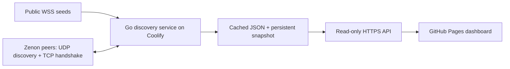

# Zenon Observatory

A mobile-friendly go-zenon version dashboard for GitHub Pages, backed by a small peer discovery API designed for Coolify.

The service uses the three public seeds to get initial peer identities, expands through **UDP discovery on port 35995**, and reads version names through the validator's **TCP/RLPx handshake**. The frontend shows provenance and timestamps for each observation. Counts are observations, never a claim to enumerate every node or pillar.

## Architecture



- `backend/`: Go service, Dockerfile, and Compose deployment. No blockchain database, wallet, votes, or transaction broadcasts. Uses go-zenon's legacy RLPx implementation for compatibility, with its own bounded discovery-v4 client.
- `src/`: React + TypeScript dashboard with a peer constellation, version distribution, search, filters, details, CSV export, and connection settings.
- `public/data/network.json`: real, timestamped bootstrap snapshot. It is **not demo data** and can become stale. Without an API configured, live seed results supplement this snapshot. Older nodes retain their individual observation times.
- `scripts/collect.ts`: optional RPC-only snapshot collector; useful for refreshing the bundled fallback. It does not implement P2P discovery.

## Deploy discovery on Coolify

1. Create an application from `https://github.com/0x3639/go-zenon-version`, branch `main`.
2. Select the **Dockerfile** build pack. Set **Base Directory** to `/backend` and **Dockerfile Location** to `/Dockerfile`.
3. Set **Ports Exposes** to `8080` and the **runtime environment variable `PORT=8080`**. Replace an existing `PORT=3000` if Coolify created one. Both values must agree. Attach your HTTPS domain, e.g. `https://discovery.example.com`. Coolify's reverse proxy routes HTTPS to container port 8080.
4. Add persistent storage mounted at `/data`. The container runs as UID/GID `10001`; storage must be writable by that user. Docker named volumes inherit the image directory's ownership. For a bind mount, provision its ownership before deployment.
5. Set `ALLOWED_ORIGINS=https://0x3639.com,https://0x3639.github.io` (use your actual Pages/custom-domain origin, without a path or trailing slash).
6. Set the health-check path to `/healthz`, and deploy. `/readyz` returns 503 until at least one peer is known.

The image defaults to port 8080, and its built-in health check follows the runtime `PORT` variable. If a deployment log says `discovery API listening on :3000`, Coolify supplied a runtime override; set `PORT=8080` and keep Ports Exposes at `8080`, then redeploy. A `connection refused` health-check error in this case is a port mismatch, not a missing `wget` command.

The service needs **outbound TCP and UDP** to peer-advertised public addresses, normally port 35995, plus outbound DNS and HTTPS/WSS to the seeds. Replies must be allowed through the firewall/NAT. It uses outbound UDP sockets with ephemeral source ports; **no public inbound P2P port mapping is required**. Only the HTTP API needs the reverse proxy. Do not route UDP through an HTTP proxy.

Alternatively, from `backend/`, deploy `compose.yaml` as a Coolify Compose application and attach a domain to the `discovery` service on port 8080. The Compose host port is loopback-only for local use; Coolify should route through its application network.

### Configuration

| Variable | Default | Meaning |
| --- | --- | --- |
| `PORT` | `8080` | API listen port |
| `DATA_DIR` | `/data` | Private discovery identity, cached snapshot, and durable crawl queue |
| `ALLOWED_ORIGINS` | `https://0x3639.com,https://0x3639.github.io` | Comma-separated browser origins; no wildcard |
| `SEED_URLS` | The three seeds below | Comma-separated WSS/HTTPS RPC endpoints, maximum 8 |
| `SCAN_INTERVAL` | `10m` | Pause after the entire known queue is drained; unfinished batches resume after 5 seconds |
| `SCAN_BUDGET` | `3m` | Maximum duration of one batch (10s–10m); remaining work stays queued |
| `MAX_NODES` | `256` | Maximum endpoint attempts per batch (1–1000), not a cap on total coverage |
| `CONCURRENCY` | `4` | Simultaneous peer probes (1–8) |
| `PILLAR_PEERS_JSON` | Empty | Optional JSON object mapping pillar producing addresses to complete 128-character P2P public keys; never infer links from IPs |

Default seeds:

- `wss://my.hc1node.com:35998`
- `wss://node.zenonhub.io:35998`
- `wss://node.atsocy.com:35998`

The service retains observations for 24 hours and stores its pending queue in `/data/crawl.json`. Every discovered public endpoint and every upstream bootstrap seed enters that queue. It attempts an authenticated TCP/RLPx hello and queries three random UDP discovery targets per peer, adds new neighbors, and resumes unfinished batches after five seconds. A completed pass means every currently known endpoint was attempted, including failures; it does not mean every node in the network was reached. Later passes retry retained endpoints after `SCAN_INTERVAL`. The queue and results are checkpointed after each batch of concurrent probes, so a restart resumes pending work. Interrupted probes return to the queue rather than being recorded as failed connections. The queue is bounded at 5,000 candidate endpoints, and `crawl.capped` exposes that limit. Inspect `crawl.pending`, `crawl.completedPasses`, `limited`, `scanning`, and each observation timestamp. The API reports observed peer identities, not registered pillars or confirmed chain membership. Handshake observations are of nodes reachable from the Zenon seed/discovery graph, but the service does not execute the chain-status handshake or validate a genesis hash. `pillarCount` is a separate on-chain registry count from `embedded.pillar.getAll`, with its own check timestamp; it is not a denominator for peer coverage.

The peer explorer labels **go-zenon seeds** by public-key membership in the validator's `p2p.DefaultSeeders` list, and **RPC seeds** by the configured endpoints' own identities. Use **Filter by node role** to show either type, all seeds, or other peers. CSV exports include those roles. Seed-list membership does not imply reachability: only observed peers enter node totals. The 116-entry catalog in `src/go-zenon-seeds.ts` is pinned to upstream commit `bb39e31c608dc397a91b98b21b096bca99a9f4d6` and matches the backend's `v0.0.9-alphanet` dependency; refresh it when updating the upstream seed list. IP addresses alone never assign a seed label.

### Peer totals and release labels

The overview and default explorer show **Reported peers** (RPC, peer-list, or P2P software-name evidence). Discovery-only neighbor referrals have their own count and **View discovery candidates** action; **All observations** retains every API identity. Failed inbound attempts and unparseable software reports remain visible. Peer collection, retention, and identity/IP deduplication are unchanged.

The adoption card counts only peers with known versions. A version newer than the GitHub release record is shown as **Highest observed version**, with the published version and lookup time separately visible. Peer advertisements do not certify releases. With no release metadata it also shows **Highest observed version**, omitting the published record and lookup time. With metadata and no newer observed version, it shows **Published release adoption**. No version is hardcoded. Charts include all reported peers, including unknown versions; the adoption denominator is narrower.

The discovery service and optional snapshot collector read releases from [zenon-network/go-zenon-releases](https://github.com/zenon-network/go-zenon-releases/releases), where v0.0.10 is published. Redeploy the discovery service in Coolify after this source correction. Cached metadata from the old `go-zenon` repository is refreshed on the next scan instead of waiting for the 24-hour cache interval; a failed lookup retains its previous value and timestamp for retry. The independent Observer needs no redeploy.

### API

| Route | Result |
| --- | --- |
| `GET /api/v1/network` | Full snapshot: nodes, source successes/failures, scan state, release metadata |
| `GET /api/v1/nodes` | `{ generatedAt, nodes }` |
| `GET /api/v1/ips` | `{ generatedAt, ips }`: one record per observed public IP, with all node identities and direct-connection counts |
| `GET /api/v1/momentums` | Upcoming production projections, recent outcomes, replay checks, and explicitly linked pillar versions |
| `GET /healthz` | Process health, scan state, observation count, last update |
| `GET /readyz` | 200 once observations exist, otherwise 503 |

Endpoints support HEAD and OPTIONS. Data responses use ETags and 30-second caching. There is no public scan trigger, target parameter, or mutation API. Anyone can read the public data; CORS controls which browser origins can consume it, not authentication.

Node fields include `id` (128-character public key), `ip`, `name`, `version` (nullable), `reportedVersions`, `evidence`, `sources`, `rpcEndpoints`, `firstSeen`, `lastSeen`, and P2P ports. Evidence is `p2p`, `rpc`, `peer`, or `discovery`. Optional `handshake` records contain `status` (`confirmed` or `failed`), the checked `ip` and `port`, `attemptedAt`, `lastSuccessAt`, and an error for unsuccessful attempts. `lastDiscoveryAt` records an authenticated UDP response. Referrals cannot refresh direct proof; changing an address or port requires a new check. Failed retries preserve earlier successful timestamps and advertised peers, since NAT, firewalls, connection limits, and peer policy can block inbound access. Versions are self-reported; authenticated P2P identity does not prove the running binary.

Peer identities and endpoint attempts are deduplicated separately. The IP endpoint and **Unique IPs** CSV export group addresses while preserving distinct keys behind the same IP. The frontend can filter by P2P result and shows observed unique IPs separately from candidate counts. Listed but unobserved bootstrap endpoints remain in the crawl ledger and never inflate the observed-node count.

### Momentum watch

Redeploy the latest backend in Coolify to enable `/api/v1/momentums`; existing port, storage, and seed settings still apply. The frontend handles an older backend's 404 with a waiting state. A separate bounded worker queries the configured RPC seeds every ten seconds, fails over between them, checks mainnet and contiguous header history, and reconstructs elections using the pinned `go-zenon/consensus` implementation. It reads current pillar weights and 180 recent momentums and serves the previous, current, and next round when the proof cutoff is covered. No full-node database or extra port is needed. The endpoint supports GET/HEAD/OPTIONS, ETags, and five-second caching.

The result is always labeled **RPC projection**: cached public weights are not authoritative historical election state. `matched` / `checked` report comparisons with actual producers; mismatches are visible. Counts are recomputed from each bounded window, not lifetime statistics. A fresh response can contain a stale frontier; the UI checks both and pauses its countdown. It only calls a slot empty when a later momentum has been observed. The reference design was [Zenon TV's spork timing tool](https://tools.zenon.tv/spork); no code or feed was copied from it.

Versions default to unknown because a pillar's Ed25519 producing address is not its secp256k1 peer identity. To attach versions later, set `PILLAR_PEERS_JSON` to a JSON object whose keys are verified producing addresses and whose values are their known peer public keys, then redeploy. There is deliberately no speculative name/IP matching. Configured links are operator assertions; the UI says so. Mapped observations older than one hour are hidden, and source evidence, times, and conflicting reports are retained. Seeing a momentum first from an IP identifies a relay observation, not proof that the IP belongs to the pillar. This release does not collect persistent P2P propagation telemetry.

The compact public-chain fixture in `backend/testdata/momentum-schedule.json` checks exact replay of 150 observed producers. The additional live check is opt-in (`CHECK_LIVE_SCHEDULE=1 go test -run TestLiveSchedule -v .` inside a Go container). Frontend checks cover invalid attribution, stale data, mismatches, and avoiding false missed-slot claims.

## Publish the frontend on GitHub Pages

1. Push the repository to GitHub.
2. In **Settings → Pages**, set the source to **GitHub Actions**.
3. In **Settings → Secrets and variables → Actions → Variables**, add repository variable `DISCOVERY_API_URL` with the HTTPS base URL of the Coolify service, e.g. `https://discovery.example.com` (no `/api/v1/network` suffix).
4. Run **Publish dashboard**, or push a frontend change to `main`.

GitHub Pages currently inherits the account’s custom domain: `https://0x3639.com/go-zenon-version/` (the standard Pages URL is `https://0x3639.github.io/go-zenon-version/`). Vite uses relative asset paths, so project Pages paths and custom domains both work. The configured API is polled once a minute while the tab is visible. Visitors can override the URL in Connection settings; an empty URL uses live public seeds and the bundled snapshot.

The workflow builds with Node inside a job container. No server-side component runs on GitHub Pages, and no API credential is embedded in the frontend.

### Experimental Observer panel

The separate P2P Observer has an optional frontend panel. It is **off by default** and must remain off until its collection pilot passes and the operator enables it. Healthy responses never enable it automatically. The existing discovery service and Momentum watch do not depend on the Observer.

| Setting | Default | Purpose |
| --- | --- | --- |
| `OBSERVER_ENABLED` GitHub Actions repository variable | Unset / off | Only the exact string `true` enables the panel in the next Pages build |
| `OBSERVER_API_URL` GitHub Actions repository variable | Supplied Coolify Observer origin | Optional HTTPS origin override, without a path, query, credentials, or fragment |
| `VITE_OBSERVER_ENABLED` | Off | Equivalent flag for direct Vite builds |
| `VITE_OBSERVER_API_URL` | `https://zsjo46q7s0qcmaklbmak7gfp.172.245.238.165.sslip.io` | Independent Observer API origin |

After pilot acceptance, set `OBSERVER_ENABLED=true` and run **Publish dashboard**. Disable it by removing the variable or setting it to `false`, then rebuild. No Coolify change or discovery backend redeploy is needed for this frontend feature. There is no query-string or browser-settings bypass. Disabled builds render neither the panel nor its navigation link and make no Observer requests; the panel is lazy loaded and has its own render error boundary.

When enabled, **Observer · Experimental** appears below the peer explorer, with **Relay associations**, **Checked momentums**, and **Peer sessions** views. In Momentum watch, the selected pillar gets an **Observed relay versions** section and a **View relay evidence** action. Opening it pins that slot and requests comparisons filtered by the **full producing address**; the 30-slot tape does not create 30 Observer requests. Changing the producing address closes the evidence and cancels its requests. Expanding an Observer momentum also shows producer-filtered relay comparisons alongside arrival evidence and dated names.

Every comparison row shows the relay's **Relay advertised version**, full peer ID, historical IP, version observation time, comparable sample count, UTC-day count, and first/last observation times. It also shows delivery coverage, strict first-arrival share and ties, median/p95 relative delay, matched other-producer baseline and excess share, and the chronological holdout result. Expand a row for cohort/boot/session IDs, baseline denominators, earlier/later halves, and daily evidence. Different cohorts and event categories remain separate rows. Missing deliveries count in the comparable denominator but supply no delay value.

`observed_relay_association` is presented as **Sample/day threshold met**: at least 100 comparable samples across three UTC days, including negative findings. It is not statistical confidence, ownership proof, or a producer-version finding. `insufficient_data` rows show remaining samples and UTC days in the same cohort/category. A page-only threshold count, reconnect/upgrade explanation, and empty-holdout-half message make collection progress distinct from a usable association result. Holdouts are descriptive heuristics; the UI explains their sample/baseline requirements and five-percentage-point margin. A single observer's routing bias remains.

The frontend accepts the exact pairs **schema 1.1 / method association-2** and **schema 1.0 / method collection-1**, rejecting other combinations. Current arrival `rankingEligible: null` means eligibility is determined by the complete comparison window; legacy `false` remains collection-only. Null pillar association bounds mean **no complete hours**, with no fabricated dates. Legacy collectors still show analysis pending.

A one-row availability request obtains the server's default window (seven complete UTC days for the current method), then the displayed association page uses fixed `from`/`to` dates. Availability requests for a selected pillar are also producer-filtered. Paging and polling retain those dates. **Update window** starts a fresh interval and resets paging; a notice offers newer complete hours without silently changing dates during polling. New hours may still await analysis. Rows are not a ranking or a network-wide verdict; users can choose 24 hours, 7 days, or 30 days, filter unsolicited event categories, and use 5/10/25 rows per page. Only the active page is retained/displayed, with **Partial results** when additional/previous pages exist. Duplicate row identities within a page are removed without pooling cohorts. Offset paging is not a snapshot; late evidence can move/repeat rows across pages. Producer filters do not change the stored baseline.

Collection routes and the active association page refresh independently about every 30 seconds while visible. Requests time out after ten seconds, reject bodies above 1 MiB, and back off after failures (up to two minutes, or five minutes for `Retry-After`). Collapsed pillar details make no requests; closing details cancels their polling. Changing pages/filters cancels the previous request and does not display a different producer's old evidence. Failed routes retain their last successful observations and original timestamps; previous-page navigation remains usable after a failed next-page request. Reduce rows/window after query/response limits.

Every feed exposes `generatedAt`, query bounds, and expandable `dataQuality`. Snapshots are stale after 90 seconds (also checking operational status); reference freshness has a separate two-minute threshold. `computedAt` describes summary computation, not response generation. Summaries being available does not imply any row meets its threshold. Processed, pending, retrying, missing and excluded hours remain visible; retrying is a subset of pending. Whole-hour exclusions are separate from the legacy combined comparison exclusion map. Missing hours and absent rows do not establish offline peers or pillars. Raw history can lag by 30 seconds; association hours have a two-minute reconciliation grace. Raw evidence expiry is labeled.

**The existing pillar software-version field stays Unknown** unless its existing configured identity link supplies an observed version. All Observer `producerSoftwareVersion` values must remain null. Relays' `advertisedVersion` values never fill that field. Arrival order, a strong association, IPs, and dated names never create pillar-to-peer mappings, and this frontend never writes `PILLAR_PEERS_JSON`. The backend and its configuration are unchanged.

Contract references: [API documentation](https://github.com/0x3639/go-zenon-pillar-version/blob/eec750f3bc31cb8f2bd523fc7066ae49435b640b/docs/api.md), [analysis interpretation](https://github.com/0x3639/go-zenon-pillar-version/blob/eec750f3bc31cb8f2bd523fc7066ae49435b640b/docs/association-analysis.md), [Observer OpenAPI](https://github.com/0x3639/go-zenon-pillar-version/blob/eec750f3bc31cb8f2bd523fc7066ae49435b640b/docs/openapi.json). The Observatory's own `openapi.json` still describes the discovery service; the Observer remains independent.

#### Frontend validation and Pages deployment

All dependency execution stays in containers:

```sh
nodebox npm ci
nodebox npm test
nodebox env VITE_OBSERVER_ENABLED=true npm run build
nodebox env VITE_OBSERVER_ENABLED=false npm run build
# Starts only a frontend preview; it does not start/redeploy a collector.
docker compose -f tests/browser/compose.yaml up -d web
docker compose -f tests/browser/compose.yaml run --rm browser
# Repeat against a disabled build/dev server:
OBSERVER_PREVIEW_ENABLED=false docker compose -f tests/browser/compose.yaml up -d web
OBSERVER_PREVIEW_ENABLED=false docker compose -f tests/browser/compose.yaml run --rm browser
# Opt-in live API/browser smoke checks (enable preview first):
OBSERVER_PREVIEW_ENABLED=true docker compose -f tests/browser/compose.yaml up -d web
docker compose -f tests/browser/compose.yaml run --rm -e CHECK_LIVE_OBSERVER=1 browser npm run test:browser -- --grep 'live Observer'
docker compose -f tests/browser/compose.yaml down
```

The preview binds only `127.0.0.1:3000`. Set `LOCAL_UID`/`LOCAL_GID` if your host user differs from the defaults. Deterministic browser tests cover desktop/mobile layouts, selected-address requests, pagination, stale/error/backoff states, legacy responses, null windows and feature-off requests. Fixtures are public 0.3.1 responses recorded November 12, 2026; they are test evidence, not live dashboard data. Live browser tests forward read-only API responses through Playwright because the production CORS allowlist excludes localhost. They separately verify `https://0x3639.com` CORS.

Merge this frontend PR to `main` after checks/review. Leave the GitHub Actions repository variable `OBSERVER_ENABLED=true` to expose the panel; the optional `OBSERVER_API_URL` must be the Observer HTTPS origin. The merge triggers **Publish dashboard**, or run it manually from Actions on `main`. Wait for its green deployment, then reload [Observer](https://0x3639.com/go-zenon-version/#observer) and inspect a selected pillar in Momentum watch. No Coolify redeploy is required. To hide all Observer UI, set `OBSERVER_ENABLED=false` and rerun **Publish dashboard**. Do not change `PILLAR_PEERS_JSON` for this feature.

## Local development

All dependency installation and execution must stay in containers. From the repository root:

```sh
nodebox npm ci
nodebox npm test
nodebox npm run build
docker compose up -d
```

Open `http://localhost:3000`. The preview binds to `0.0.0.0` inside the container and publishes only on host loopback. On systems with a different UID/GID, set `LOCAL_UID` and `LOCAL_GID` to the output of `id -u` and `id -g`.

Start the discovery service locally:

```sh
ALLOWED_ORIGINS=http://localhost:3000 docker compose -f backend/compose.yaml up --build -d
```

Set the frontend's Connection settings to `http://localhost:8080`. HTTP is permitted only for local development. Stop both services with their corresponding `docker compose down` commands when finished; volumes preserve discovery state.

Refresh the real RPC fallback snapshot:

```sh
nodebox npm run collect
```

The collector uses bounded requests to discovered **public IPs** on port 35997. It refuses redirects and private/reserved destinations and retains the previous file when every seed fails. HTTPS/WSS seeds validate certificates; peer HTTP responses are untrusted self-reports. Use the Coolify service for non-RPC peers.

## Coverage and references

One seed's connected peers are only one neighborhood. UDP `findnode` returns a bounded set of neighbors near a target, not the entire network. Nodes may be private, offline, behind NAT, at capacity, or unwilling to complete a handshake. Running over time improves coverage; an exact total is unknowable from this crawler. Multiple pillar registrations are not equivalent to peer identities, and regular/sentinel nodes also participate.

The dashboard parses the raw `name` field because the current TypeScript SDK's `Peer.fromJson` omits it. Unknown and conflicting version reports remain visible. Upstream `stats.networkInfo` can also truncate IPv6 addresses; the P2P path uses its own address parsing.

- [go-zenon statistics API](https://github.com/zenon-network/go-zenon/blob/master/rpc/api/stats.go)
- [go-zenon P2P implementation](https://github.com/zenon-network/go-zenon/tree/master/p2p)
- [TypeScript SDK peer model](https://github.com/digitalSloth/znn-typescript-sdk/blob/main/src/model/stats.ts)
- [sol-znn node parser](https://github.com/sol-znn/znn-node-parser) — reviewed as a reference for RPC-based crawling; its source was not copied.
- [Coolify Dockerfile deployment documentation](https://coolify.io/docs/applications/builds/dockerfile)
- [GitHub Pages custom workflow documentation](https://docs.github.com/en/pages/getting-started-with-github-pages/using-custom-workflows-with-github-pages)

Go dependencies include go-zenon and go-ethereum and retain their upstream licenses. See `backend/go.mod` / `go.sum` for pinned versions. The discovery code intentionally uses the validator's legacy handshake implementation for compatibility.
