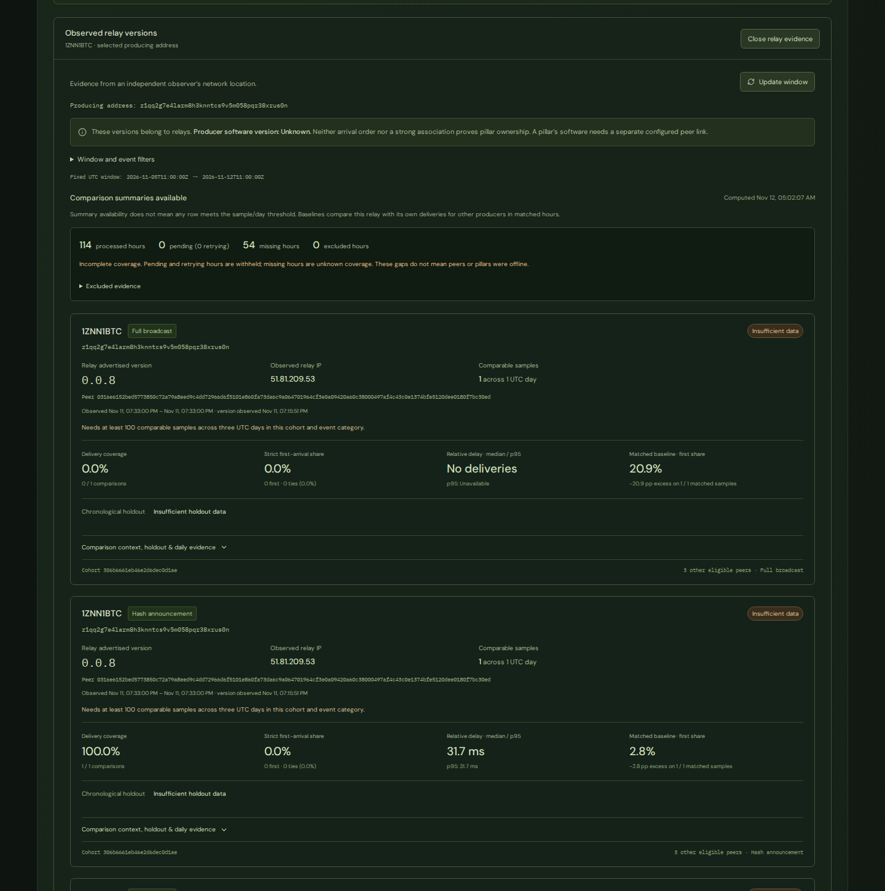
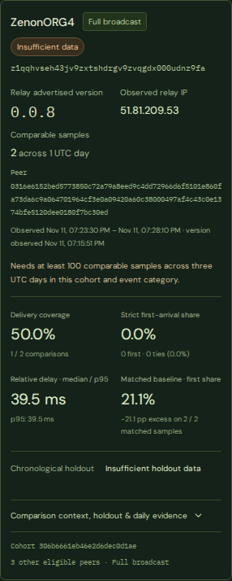

# Observer association frontend validation

Validated November 12, 2026, against Observer release `0.3.1-associations`, schema `1.1`, method `association-2`. These previews show real public API observations in a local frontend build, not a production Pages deployment. Names are dated display labels; relay versions do not identify a pillar's software.

## What changes next to pillars

Momentum watch keeps its existing software badge and adds **Observed relay versions → View relay evidence** for the selected producing address. Opening evidence pins the slot and loads only that full address's comparisons. It shows relay advertised version, historical IP/full peer ID, samples/UTC days, observation window, evidence status, delivery/first-arrival measurements, delays, matched baseline, and holdout. Separate cohort/event rows remain separate. Controls in selected details expand under **Window and event filters**.

The existing badge remains **Unknown** without a separately configured identity link. A configured `v0.0.9` badge stays `v0.0.9` even when the Observer relay advertises `0.0.8` (covered in browser tests). No observer field is promoted to a pillar version, ownership probability, or `PILLAR_PEERS_JSON` entry.

## Results

| Check | Result |
| --- | --- |
| `nodebox npm test` | 38 passed, including recorded current-contract fixtures and legacy coverage |
| Production build, `VITE_OBSERVER_ENABLED=true` | Passed TypeScript, Vite, generated-site verification |
| Production build, `VITE_OBSERVER_ENABLED=false` | Passed the same checks |
| Enabled desktop/mobile browser checks | 12 passed |
| Disabled desktop/mobile browser checks | 2 passed; zero Observer requests over 65 simulated seconds |
| Live desktop/mobile browser checks | 2 passed |
| Live parser/query smoke | All six routes, full-address filtering and second-page fixed bounds passed |
| Layout | 1440px desktop and 390px mobile; no horizontal body overflow, details usable |

Browser checks cover null association windows and nullable ranking eligibility, insufficient-data rows, matching full addresses, distinct event/cohort rows, retained stale/error evidence, Retry-After backoff when the header is browser-visible, recovery, pagination and a failed next-page request, legacy analysis-pending behavior, and independent configured versions. The existing unit tests also reject unsupported contracts and fabricated producer versions. Association coverage remains incomplete in the real data and is labeled in the preview; this validation is not acceptance of any ownership inference.

All package installation, builds, tests, browser execution and preview services used `nodebox` or Docker Compose. The live browser check forwards read-only responses through Playwright because the production API allows `https://0x3639.com`, not the local preview origin; it separately verifies that exact production CORS header. No production API configuration was changed. Reproduction commands are in the README.

## Preview evidence

Desktop selected-pillar evidence (live data):

Mobile relay comparison from a selected pillar (live data):

## GitHub Pages rollout

1. Review and merge the frontend PR to `main`.
2. Keep the repository Actions variable `OBSERVER_ENABLED=true`. `OBSERVER_API_URL` is optional; its default is the existing Observer HTTPS origin.
3. The merge triggers **Publish dashboard**. Alternatively, open Actions → Publish dashboard → Run workflow → `main`.
4. After the green deployment, reload `https://0x3639.com/go-zenon-version/#observer`. Inspect Relay associations, then select a Momentum watch pillar and choose View relay evidence.
5. To hide the experimental feature, set `OBSERVER_ENABLED=false` and run Publish dashboard again.

No Coolify redeploy or backend changes are required. This PR does not itself merge or publish the production site.
